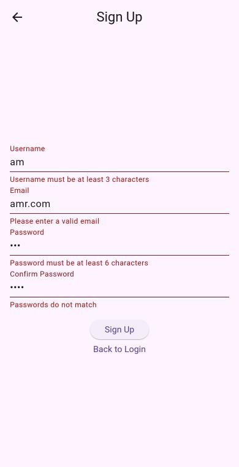
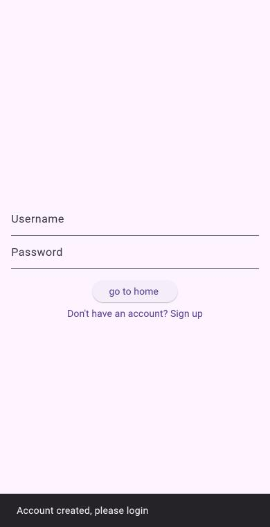

# Shopping App — Section 5 Task (Signup, Navigation, const & super.key)

## ▶️ Live demo
**https://amr-elgharip2006.github.io/flutter-shopping-app/**

**Student:** Amr Ahmed Elgharip

Built on [flutter-course-section-5](https://github.com/Atef-Mousa/flutter-course-section-5).
Login with `Atef` / `Atef12345`, or create a new account from **Sign up**.

- **Part 1 – super.key:** every page has a `const` constructor with `{super.key}` (`LoginPage`, `HomePage`, `ProductsPage`, `SignupPage`).
- **Part 2 – const:** `const` on the constructors, the routes in `router.dart`, and the fixed `Text`s and `SnackBar`s.
- **Part 3 – private State:** `_LoginPageState`, `_HomePageState`, `_ProductsPageState`, `_SignupPageState`. Their fields are private too.
- **Part 4 – Signup:** `lib/signup_page.dart` has a `Form` with 4 validated fields. On submit it updates `Database`, shows *"Account created, please login"* and goes back with `context.pop()`. All the controllers are disposed in `dispose()`.
- **Part 5 – Navigation:**
  - top-level `/signup` route;
  - Login → Signup with `context.push`, and back with `context.pop`;
  - the hidden bug in Home: `pop()` after `go("/home")` gives *"There is nothing to pop"*, so the button is now **Logout** (`go("/login")`).

**Answers in the code:**
- Parts 1–3: at the top of `lib/login_page.dart`
- Part 5.1, the 4 go/push tests and go vs push: `lib/router.dart`
- Hidden bug: `lib/home_page.dart`

> Note: I'm on Flutter 3.41, so `go_router` is `^17.5.0` (`^18.1.1` needs a newer Flutter). The API is the same.

## Screenshots
| Sign up validation | Account created |
|---|---|
|  |  |

## Run
```bash
flutter pub get
flutter run -d chrome
flutter test
```
